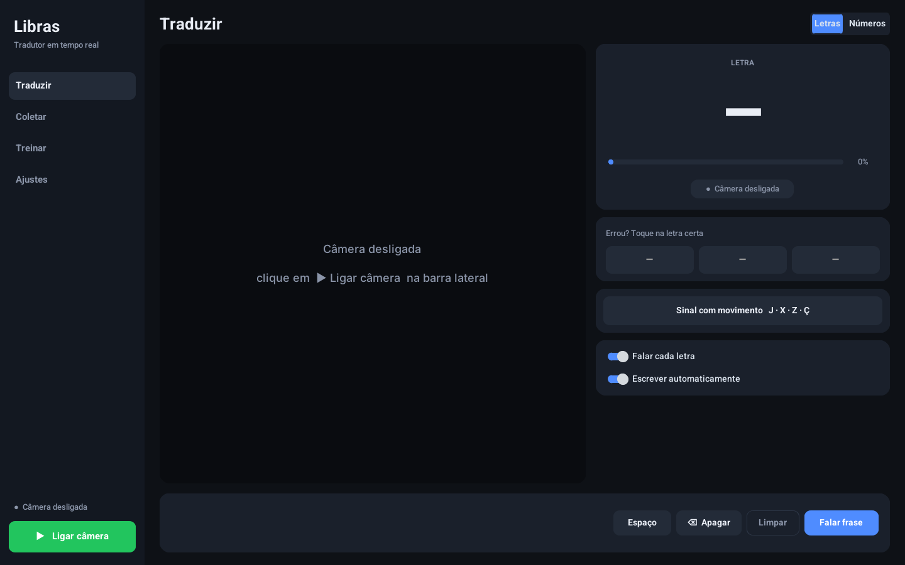
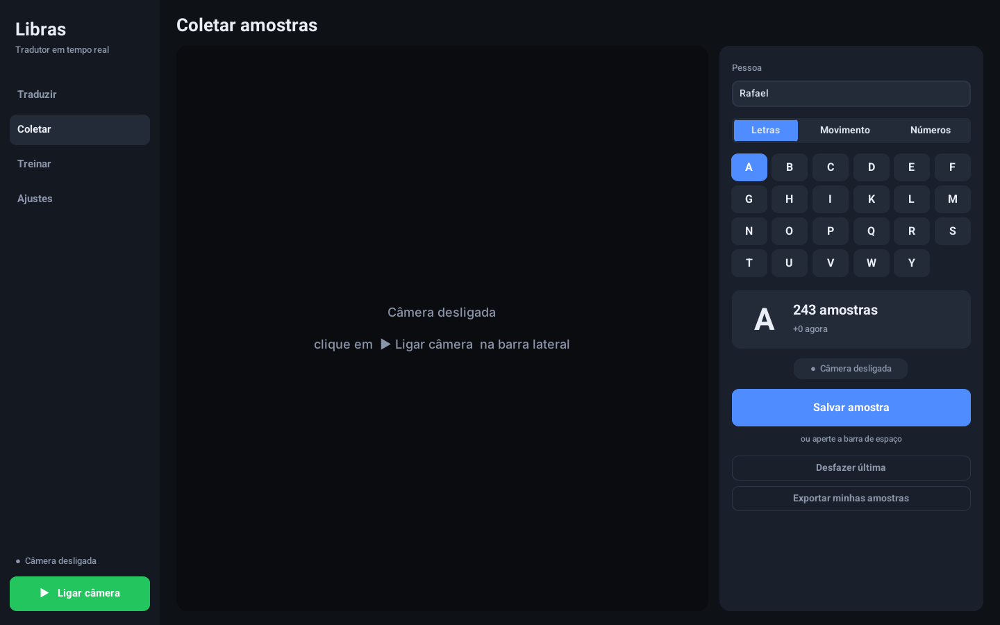
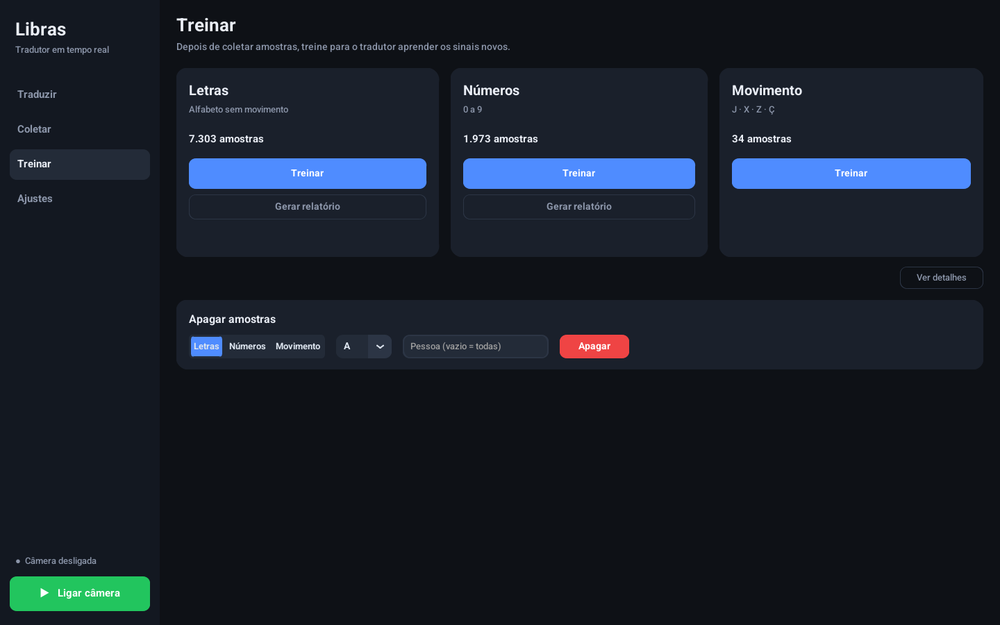

# Tradutor de Libras em tempo real

Aplicativo desktop que reconhece, pela webcam, o alfabeto manual da Língua Brasileira de Sinais (Libras) e os numerais de 0 a 9, escreve as letras na tela e as fala em voz alta. Roda localmente, sem internet, luvas ou sensores.

Trabalho de Conclusão de Curso do Curso Superior de Tecnologia em Sistemas para Internet do IFSul, Câmpus Charqueadas.



**Quer ajudar a pesquisa?** O modelo hoje foi treinado com os sinais de uma única pessoa. Contribuições de outras pessoas ajudam o sistema a reconhecer mãos e jeitos de sinalizar diferentes. Veja [Como contribuir com dados](#como-contribuir-com-dados).

## O que o sistema reconhece

| Tipo | Sinais |
| --- | --- |
| Letras estáticas | A–Z, exceto J, X e Z (23 letras) |
| Letras com movimento | J, X, Z e Ç |
| Numerais | 0 a 9 |

## Como funciona

1. A câmera captura a imagem e o **MediaPipe Hands** encontra 21 pontos da mão.
2. Os pontos são **normalizados** (o pulso vira a origem e o tamanho da mão é padronizado), então a posição e a distância da mão não importam.
3. Um classificador **Random Forest** (scikit-learn) diz qual sinal aqueles pontos formam.
4. A letra só é escrita e falada quando fica **estável** por alguns quadros, o que evita letras erradas piscando na tela.

Nenhuma imagem é salva: o sistema guarda apenas as coordenadas dos pontos da mão.

## Instalação

**Requisitos:** Windows 10 ou 11, uma webcam e **Python 3.11** ([download](https://www.python.org/downloads/release/python-3119/); na instalação, marque *Add python.exe to PATH*).

Abra o terminal (PowerShell ou o terminal do VS Code) e rode:

```bash
git clone https://github.com/Rafael8353/Sistema-Reconhecimento-Libras.git
cd Sistema-Reconhecimento-Libras

python -m venv .venv
.venv\Scripts\activate

pip install -r requirements.txt
```

> Sem o Git instalado, use **Code → Download ZIP** no GitHub, extraia a pasta e rode os comandos a partir de `python -m venv .venv`.

## Como usar

Com o ambiente ativado (`.venv\Scripts\activate`), inicie o aplicativo:

```bash
python scripts/gui_app.py
```

Clique em **▶ Ligar câmera**, no canto inferior esquerdo, e use as telas da barra lateral:

| Tela | Para que serve |
| --- | --- |
| **Traduzir** | Mostre um sinal para a câmera. A letra aparece em destaque e vai sendo escrita no texto. Escolha *Letras* ou *Números* no canto superior direito. Para J, X, Z e Ç, clique em *Sinal com movimento* e faça o sinal depois do aviso. Se o sistema errar, toque na letra certa em *Errou? Toque na letra certa*. |
| **Coletar** | Grava amostras novas: escreva seu nome, escolha a letra e clique em *Salvar amostra* (ou aperte a barra de espaço). |
| **Treinar** | Treina os modelos com as amostras coletadas e gera os relatórios de avaliação. |
| **Ajustes** | Câmera, resolução, confiança mínima e estabilidade do reconhecimento. |





**Dicas:** luz de frente (não de costas), fundo liso, a mão inteira dentro do vídeo e o sinal firme por meio segundo.

## Como contribuir com dados

Leva cerca de 30 minutos. Você só precisa de uma conta no GitHub e de uma webcam.

### 1. Faça um fork e instale

No topo desta página, clique em **Fork** para criar uma cópia do projeto na sua conta. Depois siga a [Instalação](#instalação) usando o endereço do **seu** fork no `git clone`.

### 2. Colete seus sinais

Abra o aplicativo, ligue a câmera e vá até a tela **Coletar**:

1. Em **Pessoa**, escreva seu primeiro nome ou um apelido. Use sempre o mesmo nome.
2. **Letras:** para cada letra, faça o sinal e aperte a barra de espaço até juntar cerca de **100 amostras**. Enquanto aperta, mexa a mão de leve: um pouco mais perto e mais longe, um pouco girada para os lados.
3. **Números:** faça o mesmo para 0 a 9, cerca de **100 amostras** cada.
4. **Movimento (J, X, Z, Ç):** clique em *Gravar movimento*, espere o aviso *Prepare-se* e faça o sinal completo. Grave cerca de **10 vezes** cada letra.

Gravou uma amostra errada? Clique em **Desfazer última** logo em seguida.

### 3. Exporte as amostras

Ainda na tela Coletar, com o seu nome no campo Pessoa, clique em **Exportar minhas amostras**. Seus dados são copiados para a pasta `contribuicoes/<seu-nome>/`.

Pelo terminal, o equivalente é:

```bash
python scripts/contribuicoes.py exportar --pessoa "Seu Nome"
```

### 4. Envie o Pull Request

Envie **somente** a pasta `contribuicoes/` (os arquivos de `data/` e `models/` mudam na sua máquina quando você coleta ou treina, e não devem ir no PR):

```bash
git checkout -b dados-seu-nome
git add contribuicoes/
git commit -m "Dados de Seu Nome"
git push origin dados-seu-nome
```

No GitHub, abra o seu fork e clique em **Compare & pull request**.

### Privacidade

Nenhuma imagem é enviada. Os arquivos contêm só as coordenadas dos pontos da mão, a letra feita e o nome que você escreveu no campo Pessoa. Ao abrir o Pull Request, você concorda que esses dados fiquem públicos neste repositório e sejam usados na pesquisa do TCC.

## Para o mantenedor: incorporar contribuições

Depois de aceitar um Pull Request:

```bash
git pull
python scripts/contribuicoes.py importar
```

O comando junta as amostras de `contribuicoes/` aos arquivos de `data/`, com backup automático, e não duplica uma pessoa que já foi importada. Em seguida, na tela **Treinar**, clique em **Treinar** e em **Gerar relatório** para cada tipo de sinal. Com mais de uma pessoa na base, o relatório passa a mostrar também o desempenho por pessoa.

## Resultados atuais

Validação cruzada em blocos de tempo, que mantém trechos inteiros de gravação fora do treino e é mais próxima do uso real. Base atual: 9.310 amostras de uma pessoa.

| Conjunto | Amostras | Acurácia (Random Forest) |
| --- | --- | --- |
| Letras estáticas | 7.303 | 97,95% |
| Numerais | 1.973 | 98,99% |

As confusões mais comuns são entre sinais parecidos, como F e T, M e N, e U, V e R. O relatório completo, com a comparação entre Random Forest, KNN e MLP e as métricas de cada letra, fica em [`models/relatorio_avaliacao.md`](models/relatorio_avaliacao.md).

## Estrutura do projeto

```
├── assets/                  prints usados neste README
├── contribuicoes/           amostras enviadas por colaboradores (uma pasta por pessoa)
├── data/
│   ├── dados.csv            letras estáticas
│   ├── dados_numeros.csv    numerais
│   └── dados_dinamicos.csv  letras com movimento
├── models/                  modelos treinados (.pkl), relatórios e matrizes de confusão
├── scripts/
│   ├── gui_app.py           aplicativo (interface gráfica)
│   ├── motor_reconhecimento.py  reconhecimento em tempo real
│   ├── normalizacao.py      normalização e atributos da mão
│   ├── treinamento.py       treino de letras e numerais
│   ├── treinamento_dinamico.py  treino dos sinais com movimento
│   ├── avaliacao.py         comparação de modelos e relatórios
│   ├── contribuicoes.py     exportar e importar contribuições de dados
│   └── ...                  módulos de apoio (coleta, voz, modos, etc.)
└── requirements.txt         bibliotecas e versões
```

O arquivo `sistema_libras.db` (SQLite, com o histórico de treinos e avaliações) é criado automaticamente na primeira vez que um modelo é treinado.

<details>
<summary>Comandos de terminal (opcional)</summary>

| Comando | O que faz |
| --- | --- |
| `python scripts/treinamento.py` | Treina o modelo de letras (`--modo numeros` para os numerais) |
| `python scripts/treinamento_dinamico.py` | Treina o modelo dos sinais com movimento |
| `python scripts/avaliacao.py` | Gera o relatório de avaliação (`--modo numeros` para os numerais) |
| `python scripts/remover_amostras.py --letra A --pessoa Nome` | Apaga amostras de uma letra, com backup |
| `python scripts/main.py` | Versão simples do tradutor, numa janela do OpenCV |

</details>

## Autoria

Rafael da Silveira Gonçales · Orientador: Prof. Dr. Rodolfo Migon Favaretto
Instituto Federal Sul-rio-grandense (IFSul), Câmpus Charqueadas
